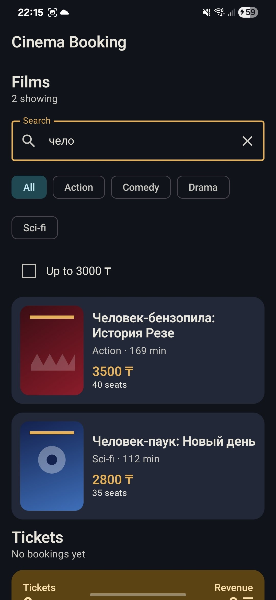
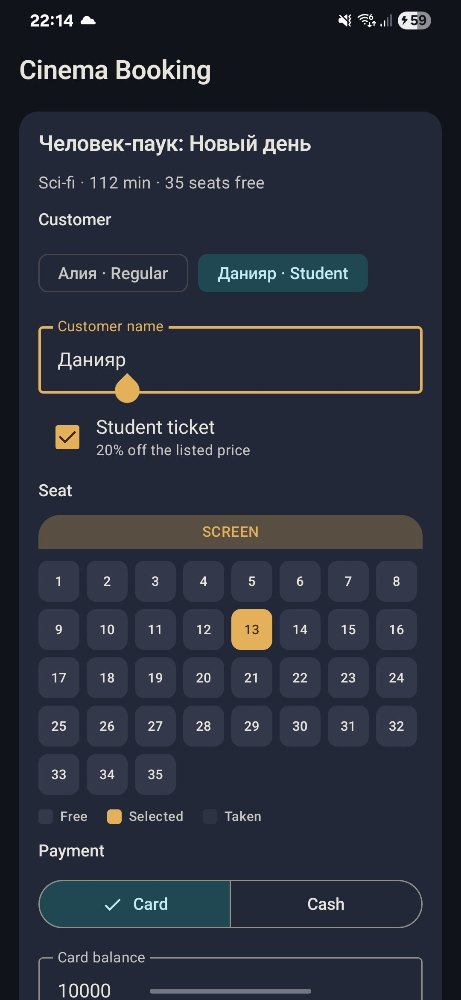

# Cinema Booking

List of films, a 20% student discount, and payment by card or cash. `CinemaViewModel` holds the catalog, the booking form, and the tickets.

## Features

- Search by title, filter by genre, and show only tickets up to 3000 ₸.
- Pick a film and a free seat. Алия is a regular customer, Данияр is a student. The price on the button changes with the student checkbox.
- A taken seat or a card balance below the price is rejected. Booked tickets and the revenue total stay on screen.
- Poster glow uses `remember` and resets on rotation. The screen note uses `rememberSaveable` and stays. Search, the form, and tickets live in the ViewModel and stay.

## Screenshots

Catalog, search, and filters:



Booking form and a completed ticket:




## Run

Open the `Assignment 2` folder in Android Studio (not the parent folder). Create a device in Device Manager, select the `app` configuration, and press Run.

From this folder:

```bash
./gradlew assembleDebug
```
