# MyCompany

An HR portal for a company. An employee sees their profile and vacation balance, creates leave requests (as drafts or straight for approval), edits and deletes them, and browses the org chart. A manager approves or rejects the requests of their direct reports. Every action is stored in a local Room database and kept in the request's history.


### Screenshots of the feature

New request with two options, *В черновик* and *Отправить*. A saved draft has the *Черновик* status, and the balance does not change.

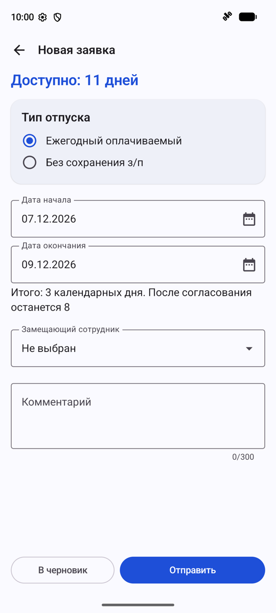
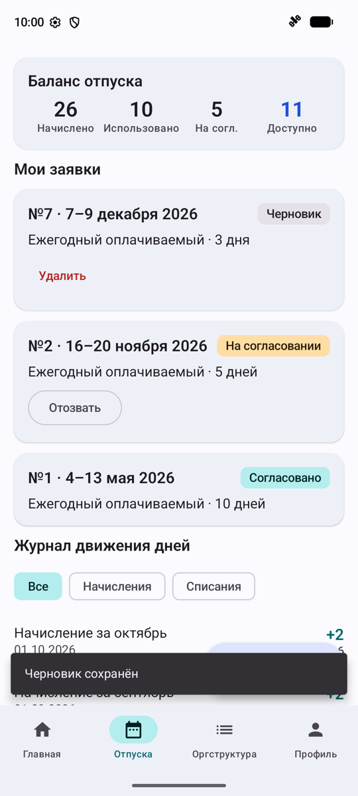

Draft details. The actions available to the author come from `LeaveWorkflow`, and the history has its first event.

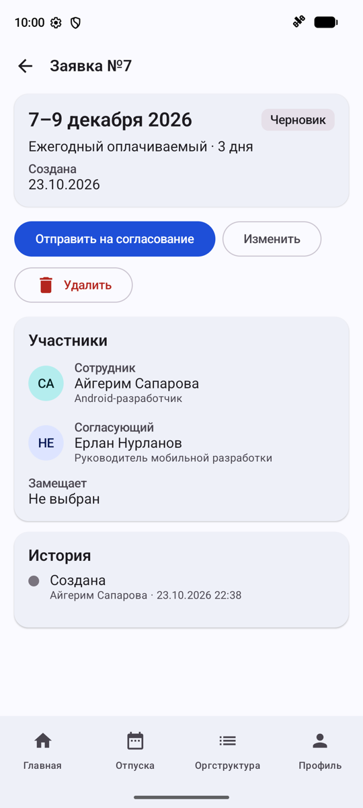

The manager rejects the request and must give a reason.

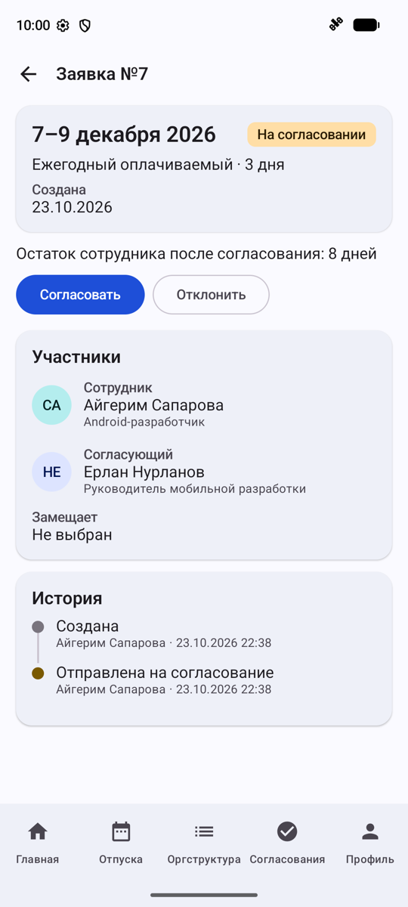
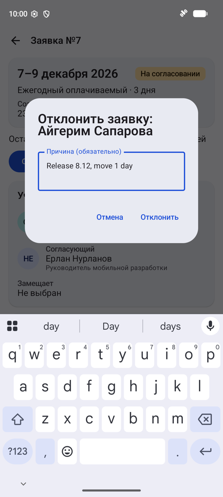

The employee sees the rejection on the home screen and in the request history, then uses *Исправить и отправить заново*.

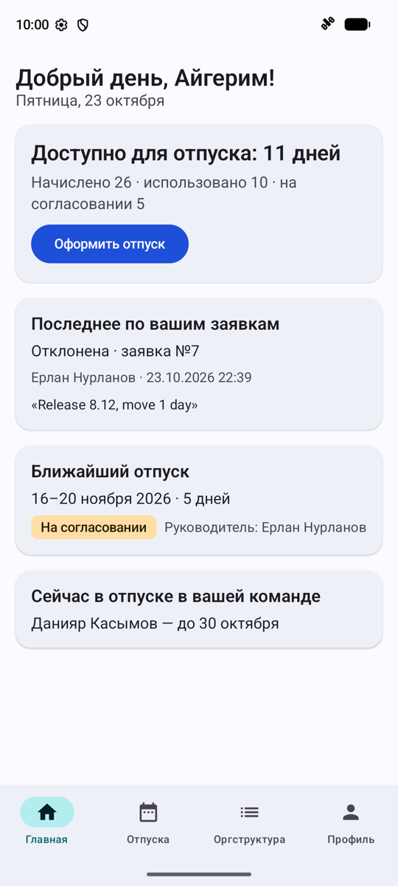
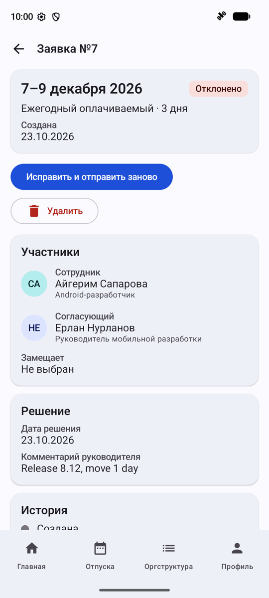
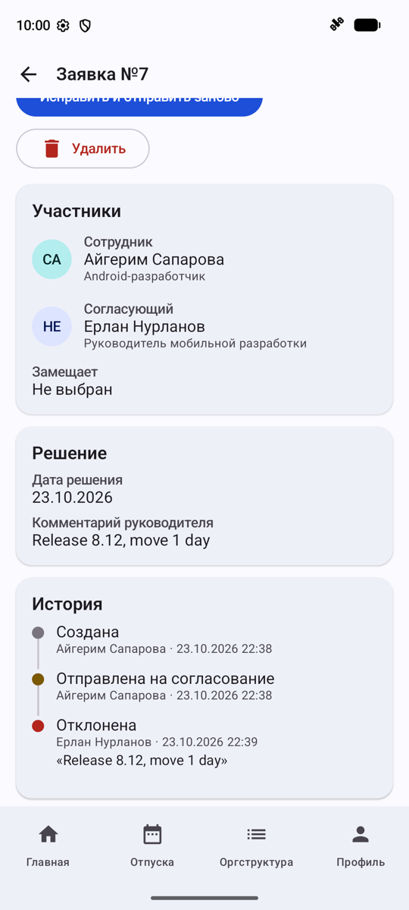

The request is back in draft. The form opens for editing with one day removed.

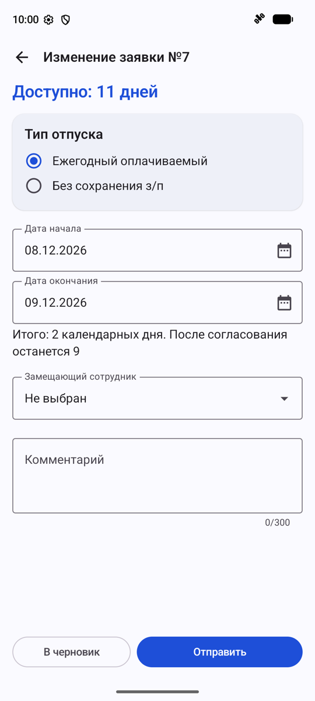

After approval, the full history of request №7 contains seven events. The vacation journal shows the days that were spent.

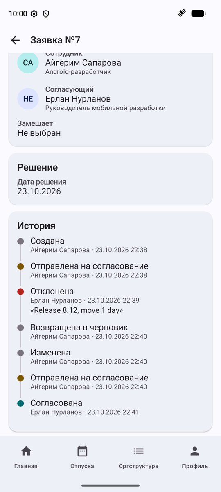
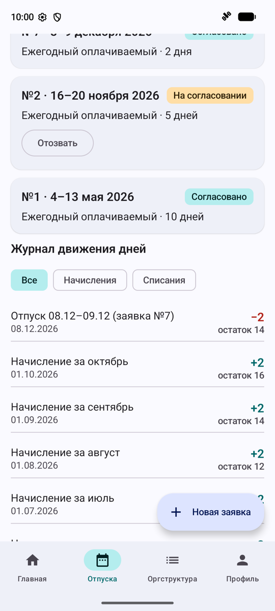

## Architecture

```
ui/              Compose screens, one ViewModel per screen, reusable components, navigation
domain/          Pure Kotlin: LeaveWorkflow, LeaveRequestValidator, LeaveLedger, OrgTree
data/local/      Room: AppDatabase, entities, DAOs, converters, mappers
data/repo/       LeaveRepository (Room), EmployeeRepository, SessionRepository
data/model/      Domain models used by UI and domain (no Room annotations)
data/mock/       Reference data (employees, departments) and demo requests for the first launch
core/            AppClock (fixed demo date 23.10.2026)
AppContainer     Manual DI: one database and one set of repositories per process
```

### Database

| Table | Entity | Notes |
|---|---|---|
| `leave_requests` | `LeaveRequestEntity` | One row per request; dates stored as ISO strings |
| `leave_events` | `LeaveEventEntity` | History; `request_id` → `leave_requests.id`, `ON DELETE CASCADE`, indexed |


### Data flow

1. A screen calls a ViewModel method, for example `LeaveDetailViewModel.submit()`.
2. The ViewModel re-validates against fresh data and calls `LeaveRepository`.
3. The repository opens a transaction. It checks `LeaveWorkflow.canPerform(...)`, updates the request and inserts a `LeaveEventEntity`.
4. Room flows emit new lists. Every ViewModel that combines them produces a new `StateFlow` value, and every visible screen recomposes. A one-off `Channel` event shows a Snackbar or navigates.

## Run

From this folder:

```bash
./gradlew assembleDebug
```

Requires JDK 17 or newer, Android SDK 37, and `minSdk` 26.
