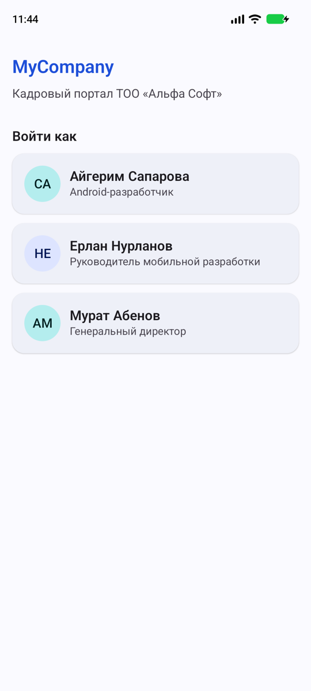
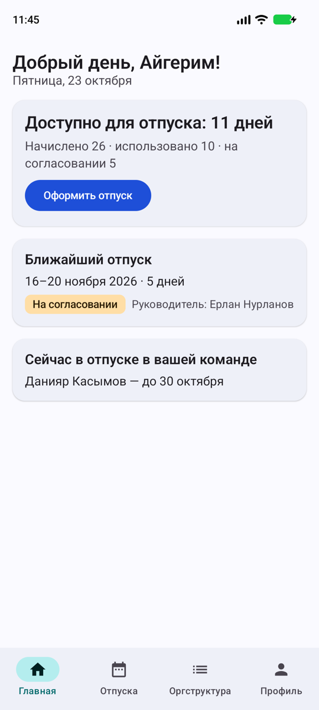
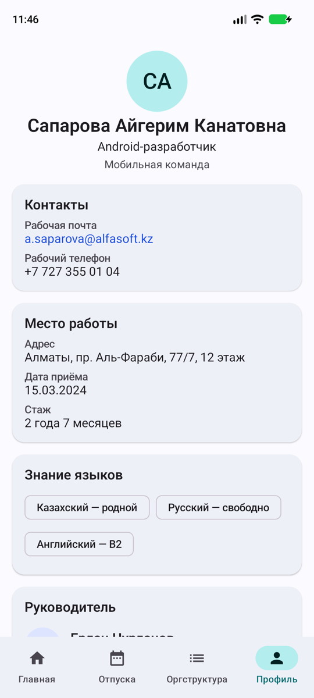
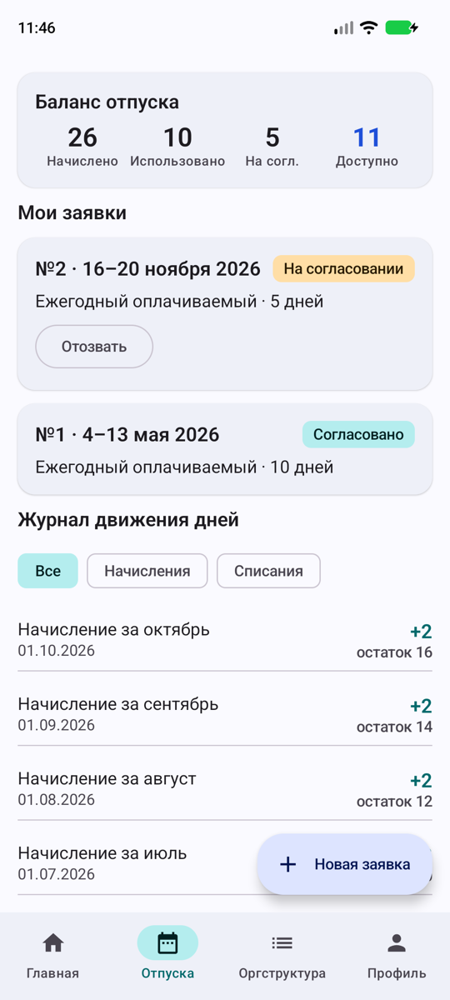
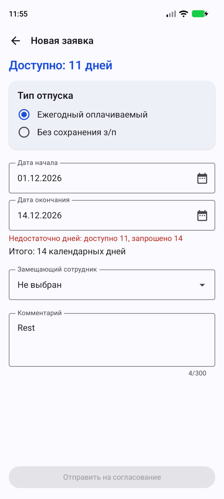
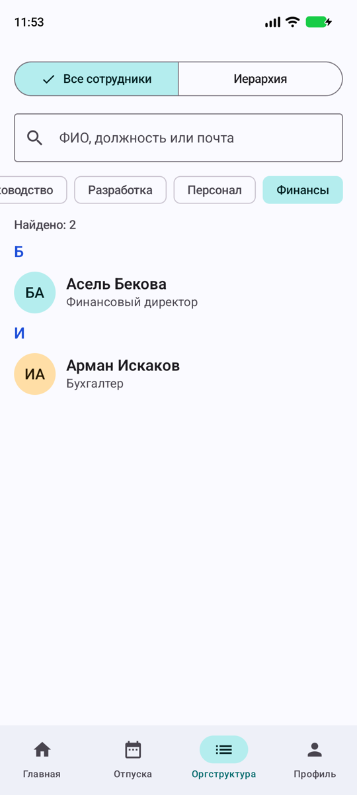
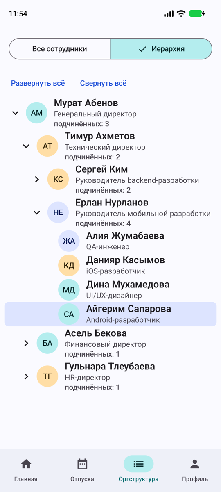
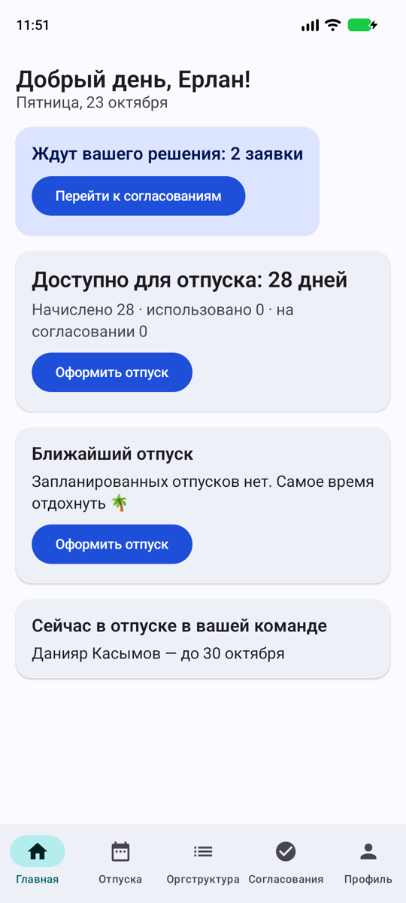
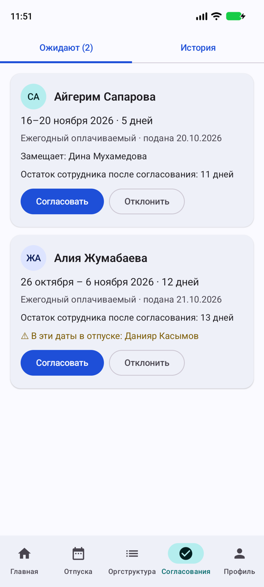

# MyCompany

An HR portal for a company. An employee sees their profile and vacation balance, requests time off, and browses the org chart. A manager approves or rejects the requests of their direct reports.

## Features

- **Profile.** Full name, work email (opens a mail client), office address, hire date and tenure, language skills, manager card. The same layout opens for any colleague, with their subordinates.
- **Vacation.** Balance (accrued, used, pending, available), the employee's own requests with statuses, and a journal of every accrual and spend with a running balance. Pending requests can be withdrawn.
- **New request.** Annual or unpaid leave, date pickers, a substitute, a comment. Validation: start from tomorrow, end not before start, enough days left, unpaid leave up to 30 days with a mandatory reason, no overlap with your own requests. The result is shown live: "14 calendar days. 11 left after approval".
- **Org structure.** Two modes. *All employees*: search by name, position or email, department chips, alphabetical groups, an "On leave until 30.10" badge. *Hierarchy*: a collapsible reporting tree that opens on the path to you.
- **Approvals (managers only).** Pending and history tabs. Each pending request shows the employee's balance and warns when a teammate is already on leave on those dates. Approve in one tap; rejecting needs a reason.

Demo users on the login screen:

| User | Role | What to try |
|---|---|---|
| Айгерим Сапарова | Employee | Balance 26 / 10 / 5 / 11, a pending request, the new request form |
| Ерлан Нурланов | Manager of the mobile team | Approvals tab with two pending requests |
| Мурат Абенов | CEO, no manager | No leave requests, org tree root |

## Screenshots

Login and the employee home screen:




Profile and the vacation page with the balance and the journal:




New request form with validation after a device rotation (values and errors are kept):



Org structure, department filter and the hierarchy:




Manager view: home and approvals with a conflict warning:




## Architecture

```
ui/            Compose screens, one ViewModel per screen, reusable components, navigation
domain/        Pure Kotlin: LeaveLedger, LeaveRequestValidator, OrgTree (no Android imports)
data/          Models, MockData, in-memory repositories on MutableStateFlow
core/          AppClock
AppContainer   Manual DI, one set of repositories per process
```

- **Navigation.** Navigation Compose with type-safe `@Serializable` routes. A bottom bar switches tabs with `saveState`/`restoreState`. The manager-only tab is filtered by `AppViewModel`. When the session ends the app returns to the login screen.
- **State.** Each screen has a ViewModel that exposes one `StateFlow<UiState>` built with `combine` over the repositories. Screens collect it with `collectAsStateWithLifecycle()`.
- **Where state lives.** Form values and filters live in the ViewModel (or `SavedStateHandle` for org search) and survive rotation. Purely visual state such as the selected tab, an open dialog or expanded tree nodes uses `rememberSaveable`.
- **State hoisting.** Screens are split into a stateful wrapper that talks to the ViewModel and a stateless `…Content` composable that takes state and callbacks.
- **Domain logic.** The vacation journal and balance are computed from the requests, so approving or withdrawing a request instantly updates every screen. Validation and tree building are pure functions covered by unit tests.
- **Coroutines.** Repository write operations are `suspend` functions with a short `delay` that imitates a network call. ViewModels run them in `viewModelScope` and show progress on the button.

## Run

Open the `Midterm` folder in Android Studio (not the parent folder). Create a device in Device Manager, select the `app` configuration, and press Run.

From this folder:

```bash
./gradlew assembleDebug
```

Unit tests (journal and balance, validation rules, org tree, repositories):

```bash
./gradlew test
```

Requires JDK 17 or newer, Android SDK 37, `minSdk` 26.
